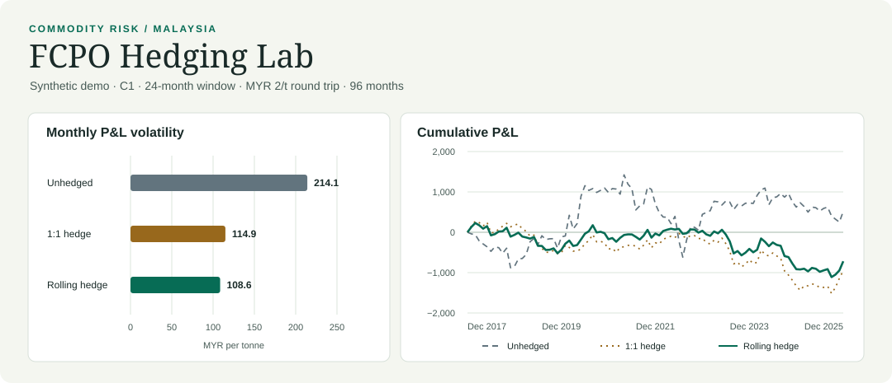

# FCPO Hedging Lab

**A walk-forward backtest for a Malaysian crude palm oil producer with long inventory exposure.** Compare an unhedged position, a 1:1 short futures hedge, and a rolling minimum-variance hedge across the same months.

**Demo data are synthetic.** The dates label simulated intervals. Results demonstrate the method and the dashboard.



**[Download the interactive dashboard](https://github.com/yuri-alpha/fcpo-hedging-lab/blob/main/docs/index.html)** · Select the download icon and open `index.html` in your browser. It works offline. Switch futures series, estimation window or assumed round-trip cost, then export the monthly results.

## What the demo shows

Default scenario uses the C1 series, a 24-month estimation window, MYR 2/t round-trip cost per unit hedged, and 96 evaluation months from January 2018 to December 2025.

| Strategy | Monthly volatility (MYR/t) | Variance reduction | Average worst 5% P&L (MYR/t) | Added-loss months |
|---|---:|---:|---:|---:|
| Unhedged | 214.1 | 0.0% | −487.7 | 0 |
| 1:1 short | 114.9 | 71.2% | −265.9 | 36 |
| Rolling minimum-variance | 108.6 | 74.3% | −244.4 | 32 |

The rolling hedge reduced variance in the simulation. It also increased a loss or turned a gain into a loss in 32 months. In the simulated September 2024 interval, spot fell by MYR 92/t while futures rose by MYR 224/t. The hedge increased the loss from MYR 92.0/t to MYR 255.4/t. The stress table highlights this kind of basis risk.

## Run locally

Python 3.11 or newer. The backtest and dashboard builder use the standard library.

```sh
python -m unittest discover -s tests -v
python build.py --open
```

The command writes [docs/index.html](docs/index.html). An offline copy of that file is sufficient to use the dashboard. The seed and stress inputs are in [demo_data.py](demo_data.py).

## Evaluation design

- **Exposure.** Track the mark-to-market change on one metric tonne of long physical inventory over each interval. The hedge is short futures. Bursa Malaysia's FCPO contract covers 25 tonnes. For example, a 0.75 hedge ratio on 1,000 tonnes corresponds to 30 short contracts. The backtest uses fractional sizing per tonne to compare strategies.
- **Sizing.** Fit an OLS slope with an intercept from the previous 12, 24 or 36 paired spot and futures changes. The short ratio is `cov(ΔS, ΔF) / var(ΔF)`, capped between 0 and 1.5. A constant futures series in the estimation window sets the target to zero for that interval.
- **Timing.** The ratio used for month *t* is estimated through *t−1*. Positions open and close within one interval. Each strategy uses the same evaluation months across all displayed windows.
- **P&L.** `ΔS − h × (ΔF + c)`, where *c* is round-trip cost per tonne hedged. The unhedged and 1:1 benchmarks use *h* of 0 and 1. Costs are flat per hedge interval and exclude financing, margin, market impact and integer lot rounding.
- **Risk.** Variance reduction is `1 − Var(hedged P&L) / Var(unhedged P&L)` using sample variances. It can be negative. The tail metric averages the worst `ceil(0.05 × n)` outcomes. The added-loss count includes any month when net hedged P&L is both negative and below unhedged P&L.

The dashboard serves as an exploratory sensitivity analysis. Real-market validation requires verified spot and futures data.

## Use your own market data

Use a signed change for the long futures leg per tonne over each matched spot interval. Document the actual contract identifiers and rolls before building the CSV. See [the data specification](data/README.md) for timing, data checks and provenance.

```sh
python build.py --input private-data/fcpo.csv --start 2018-01 --end 2025-12 --source "MPOB spot and licensed BMD settlements" --open
```

The custom dashboard defaults to `build/index.html`. Its output contains monthly changes and scenario P&L. Check your data rights before sharing it.

## Sources and repository layout

- [Bursa Malaysia Derivatives FCPO contract specification](https://www.bursamalaysia.com/sites/5d809dcf39fba22790cad230/assets/5fe19f5a5b711a33e44e1e3d/BURSA_FCPO_Brochure_EN_for_preview_MA.pdf)
- [Malaysian Palm Oil Board local delivered CPO quotations](https://bepi.mpob.gov.my/admin2/price_local_daily_view_cpo_msia.php?jenis=1W&more=Y)
- [Backtest](hedge_lab.py) · [Dashboard builder](build.py) · [Frontend](web/) · [Tests](tests/)

To serve the dashboard on GitHub Pages, choose **Settings → Pages → Deploy from a branch → main /docs**. See the [GitHub Pages guide](https://docs.github.com/en/pages/getting-started-with-github-pages/configuring-a-publishing-source-for-your-github-pages-site).
